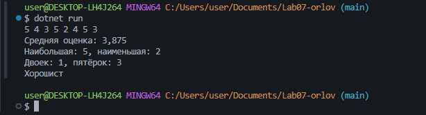
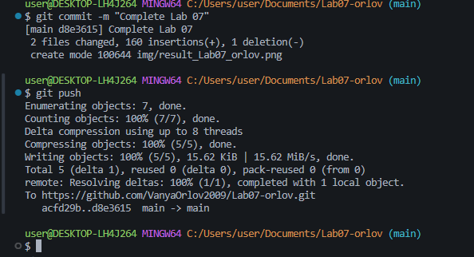

# Практическая работа №7

**ФИО:** Орлов Иван Леонидович
**Группа:** ИСП-241
**Дата:** 07.11.2026

## Что изучено

- Индекс начинается с 0, а последний элемент это Length - 1
- foreach удобен, когда нужно только прочитать элементы, а for нужен, когда надо менять элементы или работать с индексом
- Я научился решать задачи с массивами: считать сумму и среднее, искать минимум и максимум, считать количество по условию

